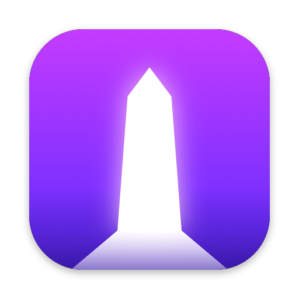

  
  <h1>Obelisk</h1>
  

    <b>Your Steam, Epic Games and GOG games together on your Mac.</b> 
    Download, update and play them from one app, Windows games included.
  

  

    <a href="https://github.com/Zagrios/obelisk/releases/latest"><b>Download</b></a>
    ·
    <a href="https://github.com/Zagrios/obelisk/issues/new">Report a bug</a>
    ·
    <a href="https://github.com/Zagrios/obelisk/issues/new">Request a feature</a>
  

  

    
    
    
    
  

## Contents

- [What is Obelisk?](#what-is-obelisk)
- [Requirements](#requirements)
- [Installation](#installation)
- [Getting started](#getting-started)
- [Features](#features)
- [Store support](#store-support)
- [Windows games](#windows-games)
- [Known limitations](#known-limitations)
- [FAQ](#faq)
- [Support](#support)
- [Credits](#credits)
- [Contributing](#contributing)

## What is Obelisk?

Obelisk is a free game launcher for Macs with Apple silicon. Sign in with your Steam, Epic Games and GOG accounts, and every game you own shows up in one library, ready to download and play.

Windows games play too. Obelisk sets everything up for you: no bottles to create, no Wine to configure, no launcher to install. Click **Download**, then **Play**.

- **One library.** Every store in one place, with search across all of them, your recently played games and what is installed on this Mac.
- **No other launcher needed.** Steam, the Epic Games Launcher and GOG Galaxy do not need to be installed. Obelisk downloads, updates and launches games itself.
- **Windows games without setup.** Windows versions run through Voile, Obelisk's Windows runtime, which Obelisk installs and keeps up to date on its own.
- **Your saves follow you.** Steam and Epic Cloud saves sync before you play and after you quit.
- **Your friends are here.** See who is online and what they play, chat with Steam friends, and invite them or join their games.
- **Made for the Mac.** A native macOS app, in light or dark appearance, in English and French.

## Requirements

- A Mac with Apple silicon (M1 or later). Intel Macs are not supported.
- macOS 26 Tahoe or later.
- Rosetta, for Windows games. If it is missing, Obelisk asks macOS to install it the first time a game needs it.
- Disk space for your games. The first Windows game also downloads Voile, a few hundred MB, once.

## Installation

1. Download `Obelisk-<version>-arm64.dmg` from the [latest release](https://github.com/Zagrios/obelisk/releases/latest).
2. Open the disk image and drag **Obelisk** onto **Applications**.
3. Open Obelisk from your Applications folder.

Obelisk is signed and notarized by Apple, so it opens without a security warning.

**Updating Obelisk:** Obelisk does not update itself yet. Download the new disk image and replace the app in Applications. Your games, saves and sign-ins stay where they are.

## Getting started

1. Open Obelisk. The **Home** page offers to sign in to each store.
2. Sign in to the stores you use:
   - **Steam:** scan the QR code with the Steam mobile app, or enter your account name and password, then confirm with Steam Guard.
   - **Epic Games** and **GOG:** a window shows the store's own sign-in page. Sign in there, and Obelisk takes over once you are done.
3. Keep **Remember me** on to stay signed in. Obelisk stores the session in your macOS Keychain, never your password.
4. Open a game and choose **Download**. Once it is installed, choose **Play**.

## Features

### Library

- **Home** shows your last game, your recently played games and the games installed on this Mac, and searches all your libraries at once.
- Each store has its own library with cover art, sorted by last played, name or playtime, and filtered to installed games, games compatible with macOS or games you have already played.
- A game's page shows your playtime, when you last played, its size, its achievements, its news on Steam and its details on Epic Games and GOG.

### Downloads and updates

- **Download** picks the Mac version of a game when there is one, otherwise the Windows version. Games download in your language when they offer it, in English otherwise.
- Downloads wait in one queue, whatever their store, and run one at a time. The **downloads** button above Settings in the sidebar shows the download speed and lets you pause, resume, reorder or remove each download.
- An interrupted download resumes where it stopped, even after quitting Obelisk.
- Games update automatically when a new version comes out. Updates wait while you play. To update only when you launch a game, turn off **Update games automatically** in **Settings → Games**.
- You can play an installed game while another one downloads.
- **Verify game files**, in the gear menu next to the **Play** button, repairs missing or damaged files. **Uninstall** is in the same menu.

### Cloud saves

- Steam and Epic Games Cloud saves sync before a game starts and after it quits.
- If your saves on this Mac and in the Cloud differ, Obelisk asks which version to keep. It never overwrites one side silently.
- A game's page shows when its saves last synced, with **Sync now** when something is waiting to be sent.

### Friends, chat and invitations

- The account menu of Steam and Epic Games opens your friends list: who is online, away or playing, and which game.
- Steam friends can chat with you in Obelisk, and you can invite them to the game you are playing.
- When a Steam friend invites you, Obelisk shows a notification. Choose **Join Game** to start the game and join them. You can also right-click a friend who is playing to join their game.
- While Obelisk is open, your Steam friends see you as online.

### In-game overlay

Press **Shift+Tab** during a game to open the overlay without leaving it. It shows your friends, the game's achievements, its store page and the invitations you received. Steam games can also ask you there to authorize an in-game purchase.

### Controllers

Gamepads work in Windows games, which see them as Xbox controllers. Mac games use macOS's own controller support.

Some controllers, such as the Steam Controller, get full support once Obelisk is allowed in **System Settings → Privacy & Security → Input Monitoring**.

## Store support

|                           | Steam | Epic Games | GOG |
| ------------------------- | :---: | :--------: | :-: |
| Mac games                 |  ✅   |     ✅     | ✅  |
| Windows games             |  ✅   |     ✅     | ✅  |
| Automatic updates         |  ✅   |     ✅     | ✅  |
| Cloud saves               |  ✅   |     ✅     | ❌  |
| Achievements              |  ✅   |     ✅     | ✅  |
| Friends list              |  ✅   |     ✅     | ❌  |
| Chat and invitations      |  ✅   |     ❌     | ❌  |
| In-game overlay           |  ✅   |     ✅     | ✅  |

Support for more stores is planned in the near future.

## Windows games

When a game has no Mac version, Obelisk installs its Windows version and runs it through [Voile](https://github.com/Zagrios/voile), a Windows runtime built on Wine, the same kind of technology as CrossOver and Steam's Proton. You do not need to do anything:

- Obelisk downloads Voile with your first Windows game and keeps it up to date.
- Each Windows game gets its own Windows environment. Uninstalling the game deletes it, after its Cloud saves are safe.
- The software a game needs, such as DirectX or Visual C++, installs by itself before its first launch.
- Direct3D 10, 11 and 12 games draw with Metal through Apple's D3DMetal.

**Anti-cheat:** We already run games whose anti-cheat supports Linux, such as **Rocket League** and **ELDEN RING**, and more are coming. We are currently working on BattlEye support, and still studying how to run games whose anti-cheat only supports Windows, such as Easy Anti-Cheat on Windows, or works at a lower level of the system. We never modify or bypass an anti-cheat, so every game runs fully legitimately.

We cannot test every game that exists. If a game does not work well, or does not work at all, please [open an issue](#support).

## Known limitations

- Only games you own through Steam, Epic Games or GOG appear. Adding other games by hand is not supported yet.
- Games install in Obelisk's library folder, shown in **Settings → Storage**. Another location cannot be chosen yet.
- Steam: Workshop content and beta branches are not available yet.
- GOG: Cloud saves, friends and GOG Galaxy's online features are not available yet. Games only offered in GOG's older download format cannot be installed yet.
- Games whose anti-cheat does not accept Wine or Linux do not run yet (see [Windows games](#windows-games)).

## FAQ

<b>Do I need Steam, the Epic Games Launcher or GOG Galaxy installed?</b>

 
No. Obelisk talks to the stores directly. It downloads, updates and launches games without them.

<b>Is my password safe?</b>

 
Obelisk never saves your password. Your Steam password goes to Steam to sign in and is then forgotten. Epic Games and GOG passwords are typed on their own websites, which Obelisk never reads. With <b>Remember me</b> on, only the session is kept, in your macOS Keychain.

<b>Where are my games installed?</b>

 
In <code>~/Library/Application Support/com.zagrios.obelisk/Games</code>. <b>Settings → Storage → Show in Finder</b> opens the folder.

<b>Can I play while something downloads?</b>

 
Yes. Any installed game launches while others download. Automatic updates pause while you play and resume afterwards.

<b>What happens if I quit Obelisk while playing?</b>

 
Closing Obelisk's window keeps the game running, and Obelisk stays in the menu bar. Quitting Obelisk stops the game, after syncing its Cloud saves.

<b>Is Obelisk free?</b>

 
Yes. Obelisk is free, and you only play games you own.

<b>How do I remove Obelisk completely?</b>

 
Deleting the app alone leaves your games and settings on the Mac. To remove everything:

1. Quit Obelisk and move it from Applications to the Trash.
2. In Finder, choose **Go → Go to Folder…**, enter `~/Library`, and delete:
   - `Application Support/com.zagrios.obelisk`: your games, their Windows environments and Voile,
   - `Caches/com.zagrios.obelisk`, `HTTPStorages/com.zagrios.obelisk` and `WebKit/com.zagrios.obelisk`,
   - `Preferences/com.zagrios.obelisk.plist`,
   - `Logs/Obelisk`.
3. In the Keychain Access app, delete the items named `com.zagrios.obelisk.steam`, `com.zagrios.obelisk.epic` and `com.zagrios.obelisk.gog`.

## Support

Found a bug or a game that does not work? [Open an issue](https://github.com/Zagrios/obelisk/issues/new) and include:

- your Mac model and macOS version,
- your Obelisk version, shown in **Settings**,
- the game, its store, and what happened.

Logs help a lot. They are in `~/Library/Logs/Obelisk` (Finder: **Go → Go to Folder…**). Attach the ones of the game you tried, after checking they show nothing you want to keep private.

## Credits

Obelisk is developed by [Zagrios](https://github.com/Zagrios)

It builds on the work of many open-source projects, without which Windows games could not run on a Mac:

- [Wine](https://www.winehq.org) and [CrossOver](https://www.codeweavers.com/crossover)'s open-source Wine by CodeWeavers, the base of [voile-wine](https://github.com/Zagrios/voile-wine).
- [Proton](https://github.com/ValveSoftware/Proton) by Valve, whose Steam bridge connects Windows games to Steam.
- Apple's [Game Porting Toolkit](https://developer.apple.com/games/game-porting-toolkit/) and its D3DMetal, which draws Direct3D with Metal.
- [FEX](https://github.com/FEX-Emu/FEX), [UTM](https://github.com/utmapp/UTM)'s Neptune and virglrenderer, and [DXMT](https://github.com/3Shain/dxmt), which power parts of the Linux engine.
- [SDL](https://github.com/libsdl-org/SDL), for gamepads, and [Wine Mono](https://gitlab.winehq.org/mono/wine-mono), for .NET games.

Obelisk is not affiliated with or endorsed by Valve, Epic Games, GOG or Apple. Steam, Epic Games, GOG and the games shown are trademarks of their respective owners.

## Contributing

Want to build Obelisk from source or help with its development? Read the [contributing guide](CONTRIBUTING.md).

[Back to top](#readme-top)

